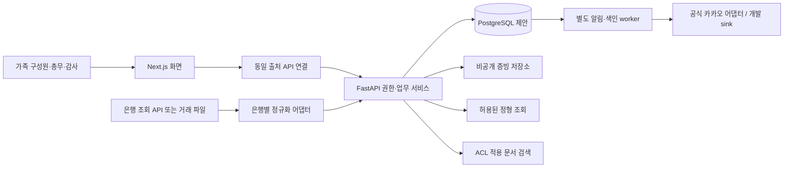

# 시스템 설계

상태: PROPOSED · 기능 제약은 [요구사항](../requirements/requirements.md)을 따른다.

## 선택안과 근거

| 선택안 | 장점 | 부담/판정 |
| --- | --- | --- |
| Next.js + 모듈형 FastAPI + 별도 worker | Python 업무 규칙, 단일 DB 트랜잭션, 단순 운영 | 권한 경계를 일관되게 구현해야 함; 권장 제안 |
| Next.js 단독 서버 | 작은 배포 단위 | Python 백엔드 조건과 맞지 않음 |
| 도메인별 마이크로서비스 | 개별 확장 | 현재 가족 규모에 비해 분산 거래·권한·운영 부담 큼; 보류 |

선택의 채택 상태는 ADR-0002에 기록한다. 현재는 사용자가 선택한 사실로 취급하지 않는다.

## 구성

은행 앱에서의 송금은 시스템 외부 활동이다. 시스템은 승인된 지급 건에 대한 수동 송금 기록과 거래 대사를 관리한다.

## 런타임 경계

- `apps/web`: App Router, TypeScript, semantic HTML, CSS 토큰. 서버/클라이언트 컴포넌트의 비밀/공개 경계를 명확히 한다. 브라우저에 은행·AI·알림 키를 보내지 않는다.
- `apps/api`: Python/FastAPI 제안. 도메인별 router → application service → repository/port → adapter. 인증/인가와 금액 계산의 권위는 여기에 있다.
- `apps/worker`: 같은 Python 도메인 패키지와 DB를 사용하되 별도 프로세스. durable outbox를 조회하여 알림·스캔·색인을 수행한다. API 프로세스의 메모리 타이머를 사용하지 않는다.
- `packages/contracts`: API 계약 스냅샷·생성 타입. 런타임별 중복 업무 로직을 두지 않는다.
- `PostgreSQL`: 로컬 네이티브 설치 제안. 실제 운영과 같은 DB로 권한·트랜잭션 테스트한다. SQLite는 격리 단위 테스트를 위한 후보일 뿐 통합 검증을 대체하지 않는다.
- 파일 저장: 로컬 개발은 Git 밖 `var/evidence`; 운영은 비공개 객체 저장소 제안. 객체 키와 다운로드 권한을 API에서 관리한다.

## 인증·권한 제안

초대된 구성원만 가족에 가입한다. 로그인 제공자(OIDC 등)는 U05 검증 후 채택한다. 검증된 인증 라이브러리/제공자를 사용하며 암호 프로토콜을 직접 만들지 않는다.

FastAPI가 관리하는 서버 세션과 HttpOnly/Secure/SameSite cookie를 제안한다. 브라우저는 `/api/v1` 동일 출처만 호출한다. 로컬 프록시와 운영 reverse proxy는 Cookie/Set-Cookie/요청 ID를 정확히 전달하며 사용자 제공 신원 헤더를 제거한다. TLS 종료 위치와 trusted proxy를 한정한다. 변경 요청에는 CSRF token 및 Origin 검사, 로그인/초대/복구에는 rate limit을 적용한다. 토큰/세션 회전·강제 종료·총무 중요 작업 재인증을 포함한다.

서버는 세션 사용자 → 활성 membership → 현재 role_assignment → action/object scope → 상태/정책 버전 순서로 매 요청 판정한다. UI는 편의를 위한 가드이며 권한의 근거가 아니다. Next.js에 DB 직접 접속을 허용하지 않는다. 개인화 응답은 `Cache-Control: private, no-store`; 공유 캐시와 정적 사전 렌더링에 가족 자료를 넣지 않는다.

## 거래와 동시성

변경 서비스는 단일 DB 트랜잭션에서 대상 버전 확인, 상태 전이, 원장/승인 레코드, 감사 이벤트, outbox를 함께 커밋한다. 외부 API는 이 트랜잭션 안에서 호출하지 않는다. worker는 claim/lease 후 외부 호출하고 결과를 저장한다. `Idempotency-Key`, 요청 본문 해시, 고유 제약으로 중복 요청을 통제한다.

배치 가져오기는 staging→검토→확정 단계를 가진다. 스테이징은 원장 집계에 포함하지 않는다. 트랜잭션 실패 시 반쪽 원장이나 알림만 남지 않아야 한다. API의 ETag/If-Match와 DB version 검사를 함께 적용한다.

## 시간·금액·데이터 출처

- KRW 정수, DB BIGINT/정수 Decimal 변환, API 정수 문자열, JS BigInt. 부동소수점 계산 금지.
- 업무 예정일 `DATE`, 시스템 사건 `TIMESTAMPTZ` UTC, 화면/알림 판정 `Asia/Seoul`.
- 잔액에는 `source`, `as_of`, `imported_at`, `coverage`, `reconciliation_status`를 표시한다. 거래 파일에서 계산한 값은 은행 실시간 잔액으로 표시하지 않는다.
- `bank_reported_balance`, `ledger_cash_balance`, `available_after_approved_commitments`는 별도 이름과 정의를 둔다. 승인 지출은 실제 출금이 아니다.

## 목표 제안과 측정

가족 1개로 시작하되 모든 데이터는 family_id로 구분한다. 합성 데이터 50명/거래 10만 건에서 일반 목록 p95 500ms, 검색 p95 2초(LLM 제외), 알림 예정시각 대비 5분 이내 처리를 초기 목표로 제안한다. 운영 SLA나 측정 결과가 아니다. 느린 엑셀 처리는 비동기 job과 진행 상태로 제공한다.

## 실제 데이터 적용 전 필요한 결정

U01/U05/U06/U07, DB/인증 의존성 잠금 및 복구 검증이 선행되어야 한다. 카카오/은행 API는 어댑터 내부 조건이 충족될 때만 켠다. 특정 공급자가 막혀도 파일 기반 회계와 웹 내부 알림 개발은 진행할 수 있다.
